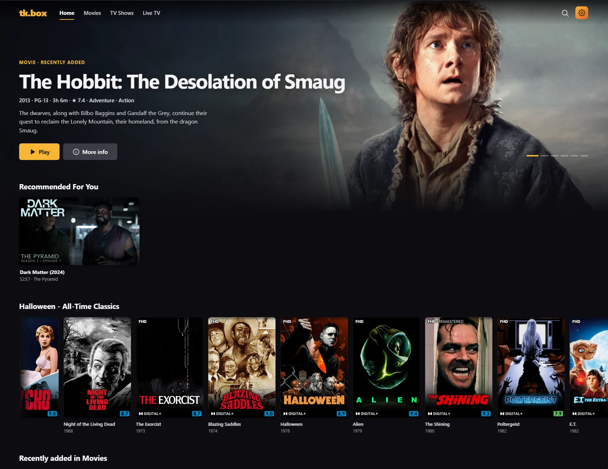
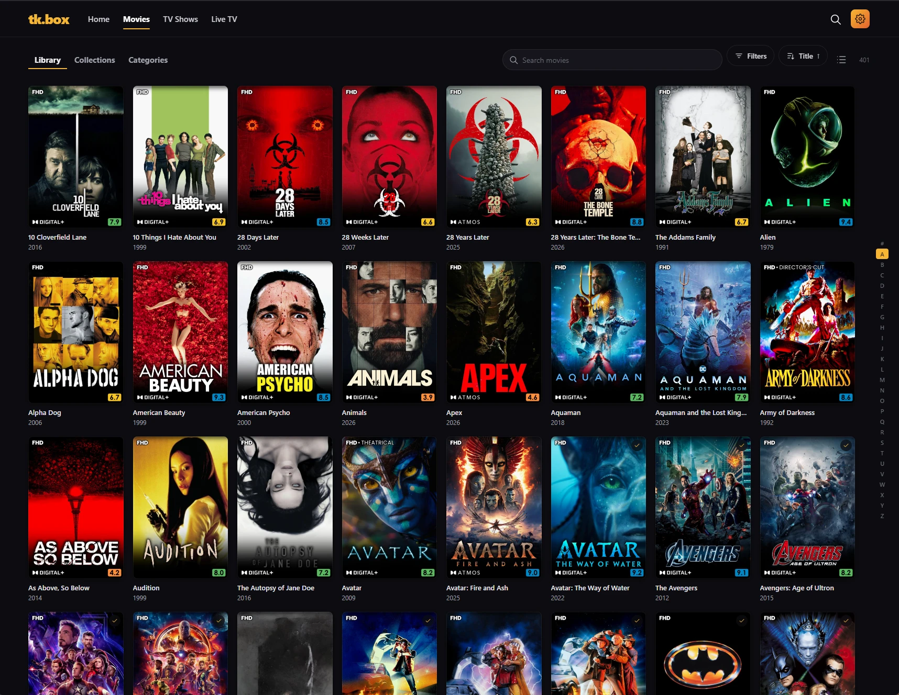
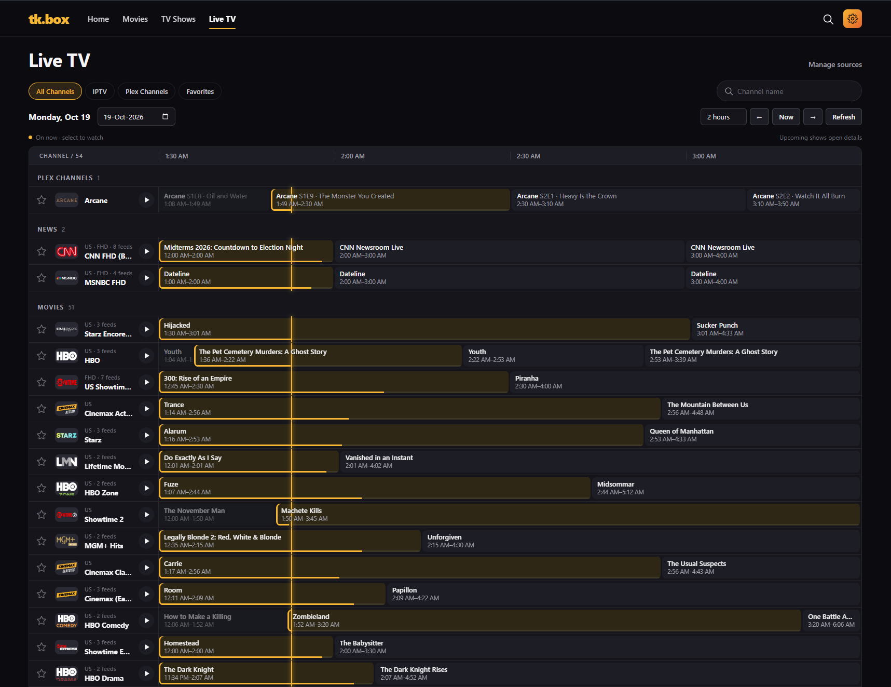
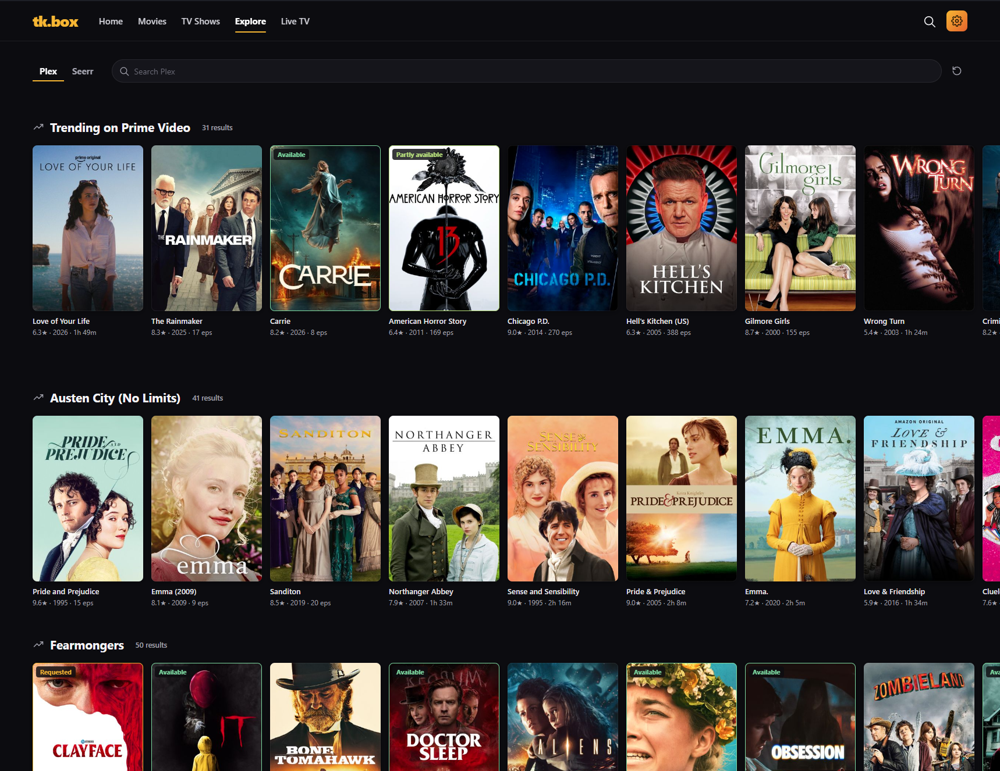

# tk.box

A self-hosted media app for your Plex server and IPTV channels. One web UI for watching your Plex movies and shows, discovering new titles, live TV, and always-on channels built from your library, plus admin tools for artwork, collections and cleanup.

> **Status:** early and in active development. Not production ready.



| Movies | Live TV |
| --- | --- |
|  |  |

## Features

- **Plex sign-in.** Your friends and Plex Home members sign in with their own Plex accounts and see the libraries you share with them.
- **Library.** Home, Movies and TV Shows with filters, sorting, collections and resume.
- **Playback.** Direct Play when the browser can play the file, otherwise Plex transcodes it.
- **Explore.** Browse Plex Discover and TMDB. Search, manage your Plex watchlist, request titles through Seerr, and discover subscription streaming catalogs and Plex-based recommendations.
- **Live TV.** M3U/XMLTV sources with a guide and favorites, and live sports events with their own channels.
- **Plex Channels.** Looping channels made from your movies, shows and collections, with Pause and Go Live.
- **Admin.**
  - Artwork: custom posters and title cards, sent to Plex.
  - Collections: franchise, streaming, chart and custom collections kept in Plex.
  - Clean Up: deletes requested titles once they've been watched.
  - Activity: shows every stream, in tk.box and other Plex apps.
  - Admins: lets the owner make other people admins.



### TMDB on Explore

Save a TMDB API key in **Admin › Artwork › Settings**. In **Settings › Explore**, choose your streaming region and services. The default region is US. Each streaming row remembers its own service in this browser, and **See all** follows that selection. Streaming rows use subscription availability from JustWatch via TMDB. The recent row uses movie release and TV premiere dates.

**Admin › Explore** controls the order of the TMDB group and its rows. Personal recommendations use titles and genres from the signed-in viewer’s accessible Plex libraries. Explore excludes known owned titles and uses popular titles when there are too few usable recommendations. Ownership checks cover up to 10,000 Plex titles and depend on a matching TMDB ID or an exact title and year. Use **Refresh** to rebuild your recommendations.

**Because You Watched** uses movies and series that Plex records as watched by the signed-in viewer within the past 90 days. A watched episode can seed its series. Explore shows up to two of these rows when it can match the watched titles to TMDB.

**Top Picks for You** uses a wider sample of the viewer’s watch activity, combining this server’s watched titles with Plex Profile history when available. With Plex watch-state sync enabled, the profile can include titles watched on other Plex servers or marked as watched in Plex Discover. Explore uses the viewer’s most-watched genres and a mix of watched movies and shows to rank TMDB recommendations. When there is no usable watch activity, it shows **Popular Picks**.

TMDB supplies the Popular, Upcoming, and streaming-service lists. Plex supplies the order and contents of its other Discover shelves. **Admin › Explore › Plex** can hide individual shelves. Viewers can hide any shelf the administrator offers in **Settings › Explore**.

## Requirements

- Node.js 22 or 24 LTS
- FFmpeg and FFprobe
- A Plex Media Server with at least one Movies and one TV library
- Python 3.10+ for Artwork, Collections and Clean Up (optional)

## Getting started

```sh
npm ci
npm run build
npm start
```

Open `http://127.0.0.1:3000`. On first run tk.box walks you through setup:

1. It finds your Plex server, or asks for its address.
2. You sign in with the Plex account that owns the server.
3. You choose your Movies and TV libraries.
4. It checks that FFmpeg, FFprobe and Python can be found.

It saves your settings to `.env` and signs you in. Your Plex token is never saved.

Setup only answers this computer and your home network. To change the address or port tk.box listens on, copy `.env.example` to `.env` and edit it before you start tk.box. It reads `.env` on its own.

For Artwork, Collections and Clean Up, install their Python packages into a virtual environment:

```sh
python -m venv .venv
.venv/bin/pip install -r apps/artwork/requirements.txt -r apps/cleanup/requirements.txt
```

On Windows the pip path is `.venv\Scripts\pip`. Then enter that environment's `python` in the setup screen's Python field, or set `PYTHON_PATH` in `.env`.

Seerr, Radarr, Sonarr, Tautulli and the artwork providers are set up later in **Admin › Connections**.

## Development

```sh
npm run dev         # backend with reload
npm run dev:web     # Vite frontend
npm run typecheck
npm test
```

`npm run doctor` checks your configuration and FFmpeg. `npm run build && npm run preview:ui` serves a UI preview with made-up data at `http://127.0.0.1:3011/__preview`.

## Project layout

| Path | Contents |
| --- | --- |
| `apps/server` | Fastify backend: Plex, IPTV, streaming, scheduling, SQLite |
| `apps/web` | React frontend |
| `apps/artwork` | Python artwork and collections engines |
| `apps/cleanup` | Python Clean Up script |
| `packages/contracts` | Shared types and settings |
| `scripts` | Setup, diagnostics and media experiments |
| `tests` | Test suite |
| `deploy` | Example systemd unit |
| `docs` | Design notes and guides |

## Docs

- [Deployment](docs/DEPLOYMENT.md)
- [IPTV](docs/IPTV_INGESTION.md)
- [Plex Channels](docs/CUSTOM_CHANNELS.md)
- [Artwork and Collections](docs/ARTWORK.md)
- [Clean Up](docs/CLEANUP.md)
- [Implementation status](docs/IMPLEMENTATION_STATUS.md)

## License

Released into the public domain under [The Unlicense](LICENSE). Dependencies keep their own licenses.
