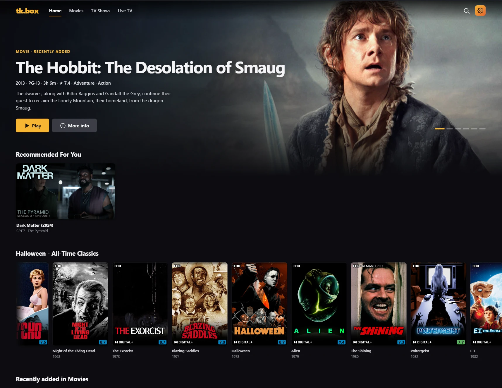
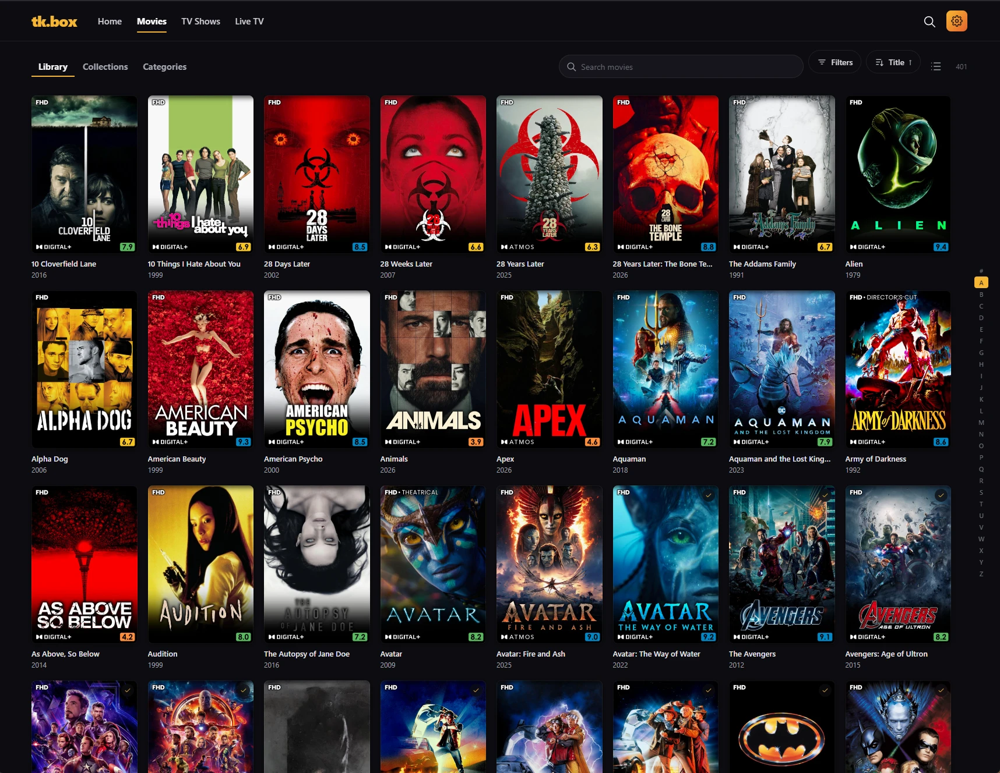
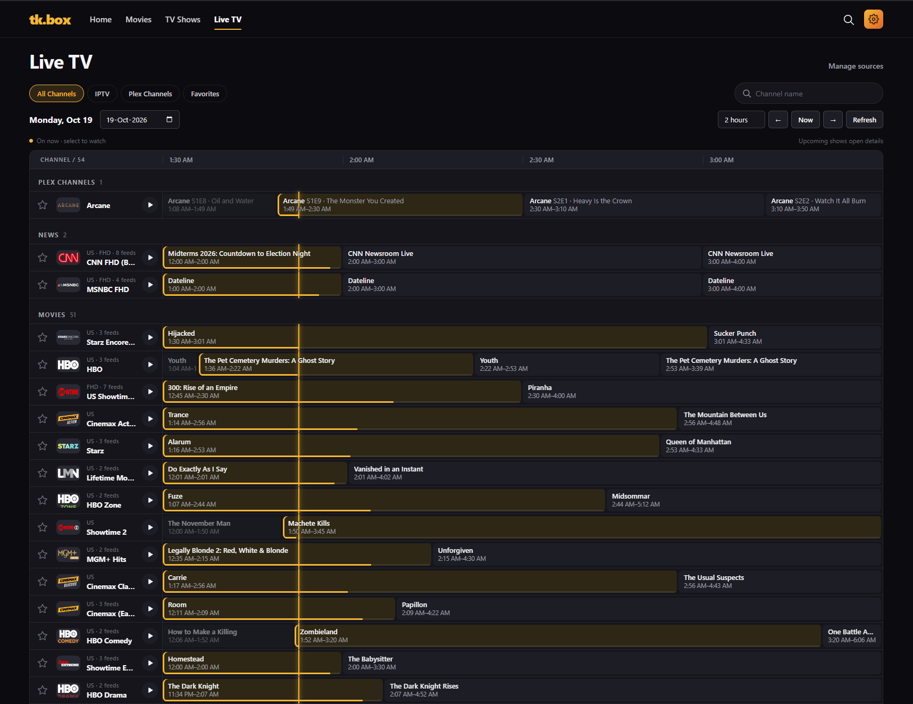
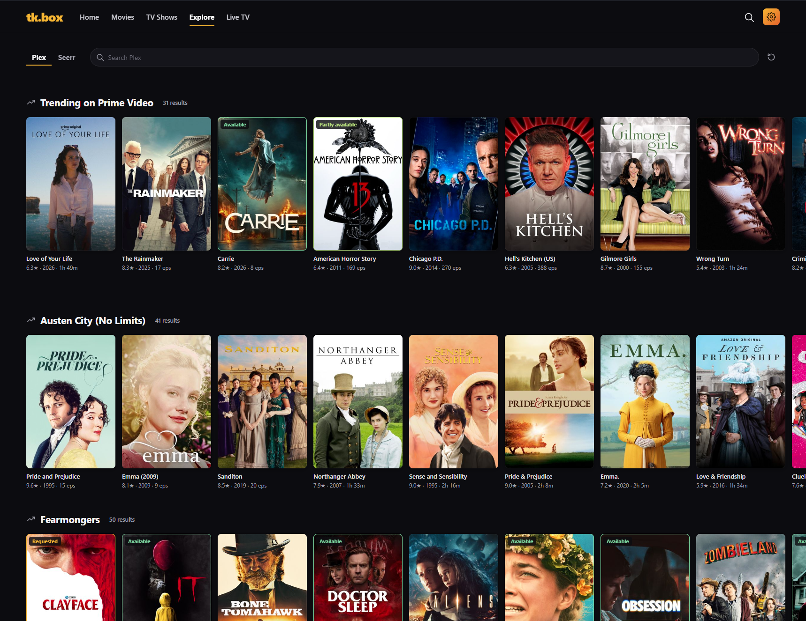

# tk.box

A self-hosted media app for your Plex server. It's where you watch your movies and shows, find new ones, request them and watch live TV. It also downloads, organizes and subtitles your library on its own, so you don't need Radarr, Sonarr, Prowlarr, Bazarr or Seerr.

> **Status:** early and in active development. Not production ready.



| Movies | Live TV |
| --- | --- |
|  |  |

## What it does

**For everyone**

- **Sign in with Plex.** Friends and Plex Home members use their own Plex accounts and see the libraries you share with them.
- **Watch.** Home, Movies and TV Shows, with filters, collections and resume. Files play directly when the browser can handle them; otherwise Plex transcodes.
- **Explore.** Browse Plex Discover and TMDB, see what's on your streaming services, get recommendations based on what you watch, and manage your Plex watchlist.
- **Request.** Ask for a movie or show and follow it until it's ready. There's an optional Requests site for people who only request.
- **Live TV.** M3U and XMLTV sources with a guide, favorites and live sports.
- **Channels.** Always-on channels looped from your own movies, shows and collections.

**For admins**

- **Downloads.** Searches Usenet (Newznab) and IPTorrents, sends to SABnzbd or qBittorrent, imports and renames the files, and upgrades them until they reach your quality profile.
- **Subtitles.** Finds English subtitles on OpenSubtitles. When there aren't any, an optional Windows tray app makes them on your own GPU with whisper.cpp.
- **Artwork and Collections.** Custom posters, title cards and collections, kept in Plex.
- **Clean Up.** Removes requested titles after they've been watched.
- **Activity and alerts.** Every stream, in tk.box or any Plex app, plus a bell for failed downloads, broken connections and request updates.



## Requirements

- Node.js 22 or 24 LTS
- FFmpeg and FFprobe
- A Plex Media Server with a Movies and a TV library
- Python 3.10+ for Artwork, Collections and Clean Up (optional)
- Go, to build the subtitle worker (optional)

## Getting started

```sh
npm ci
npm run build
npm start
```

Open `http://127.0.0.1:3000` and follow the setup. tk.box finds your Plex server, has you sign in with the account that owns it, lets you pick your libraries and checks for FFmpeg and Python. Settings are saved to `.env`; your Plex token isn't.

Setup only answers on this computer and your home network. To change the address or port, copy `.env.example` to `.env` and edit it first.

Indexers, download clients, TMDB, OpenSubtitles and artwork providers are added later in **Admin › Connections**.

### Python features

Artwork and Collections need their Python packages, ideally in a virtual environment:

```sh
python -m venv .venv
.venv/bin/pip install -r apps/artwork/requirements.txt
```

On Windows use `.venv\Scripts\pip`. Then point setup's Python field (or `PYTHON_PATH` in `.env`) at that environment's `python`.

### Subtitle worker

See [apps/subtitle-worker](apps/subtitle-worker/README.md) to build it and set it up on a Windows PC with an NVIDIA GPU.

## Development

```sh
npm run dev         # backend with reload
npm run dev:web     # Vite frontend
npm run typecheck
npm test
```

- `npm run doctor` checks your configuration and FFmpeg.
- `npm run preview:ui` serves the UI with made-up data at `http://127.0.0.1:3011/__preview` (run `npm run build` first).
- `npm run preview:plex` serves a read-only copy of your tk.box at `http://localhost:3012`, against your real Plex server. Settings you change stay in the copy, and writes to Plex, downloads and file changes are blocked. Playback still uses Plex.

## Project layout

| Path | Contents |
| --- | --- |
| `apps/server` | Fastify backend: Plex, library, downloads, IPTV, streaming, SQLite |
| `apps/web` | React frontend |
| `apps/artwork` | Python artwork and collections engines |
| `apps/subtitle-worker` | Windows tray app that makes subtitles with whisper.cpp |
| `packages/contracts` | Shared types and settings |
| `scripts` | Setup, diagnostics and previews |
| `tests` | Test suite |
| `deploy` | Example systemd unit |
| `docs` | Guides |

## Docs

- [Deployment](docs/DEPLOYMENT.md)
- [Artwork and Collections](docs/ARTWORK.md)
- [Clean Up](docs/CLEANUP.md)
- [Subtitle worker](apps/subtitle-worker/README.md)

## License

Released into the public domain under [The Unlicense](LICENSE). Dependencies keep their own licenses.
