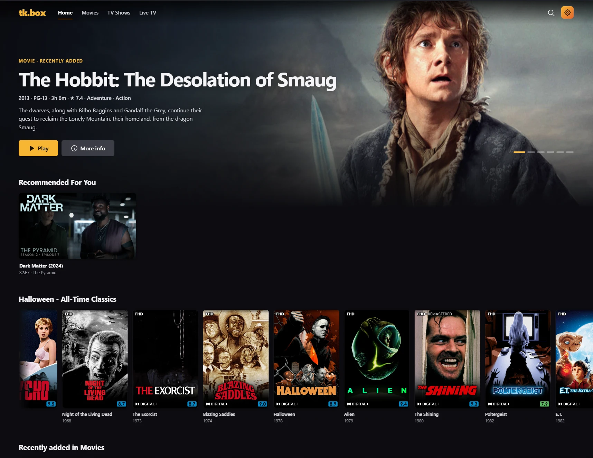
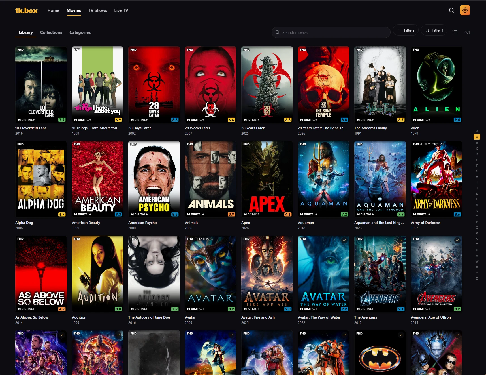
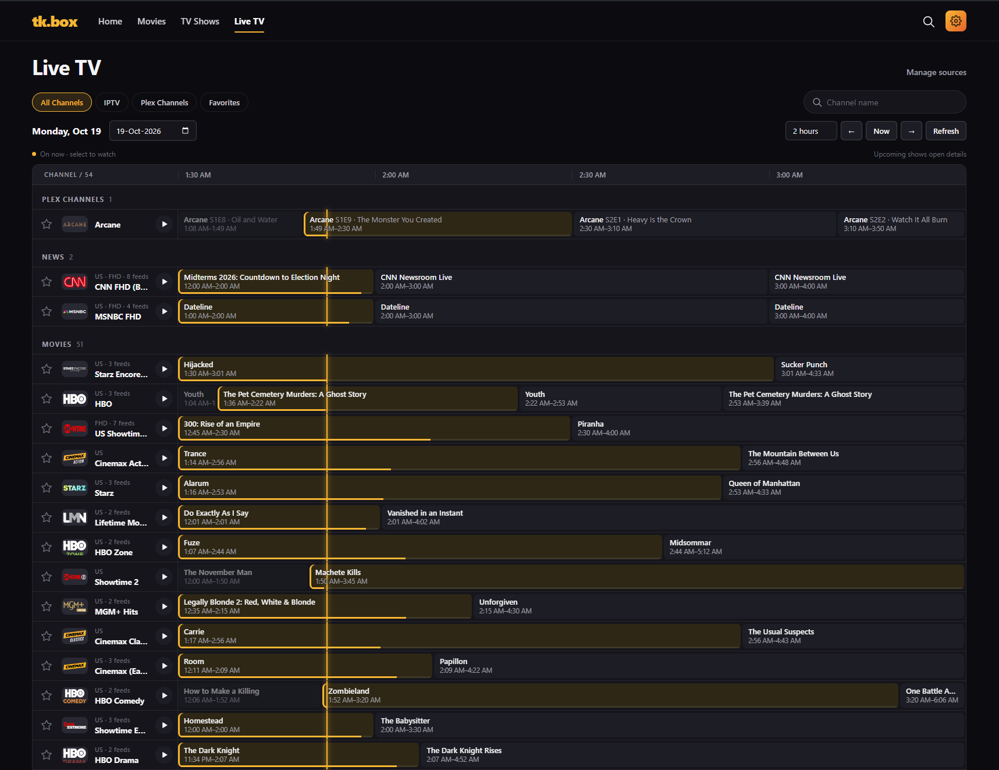
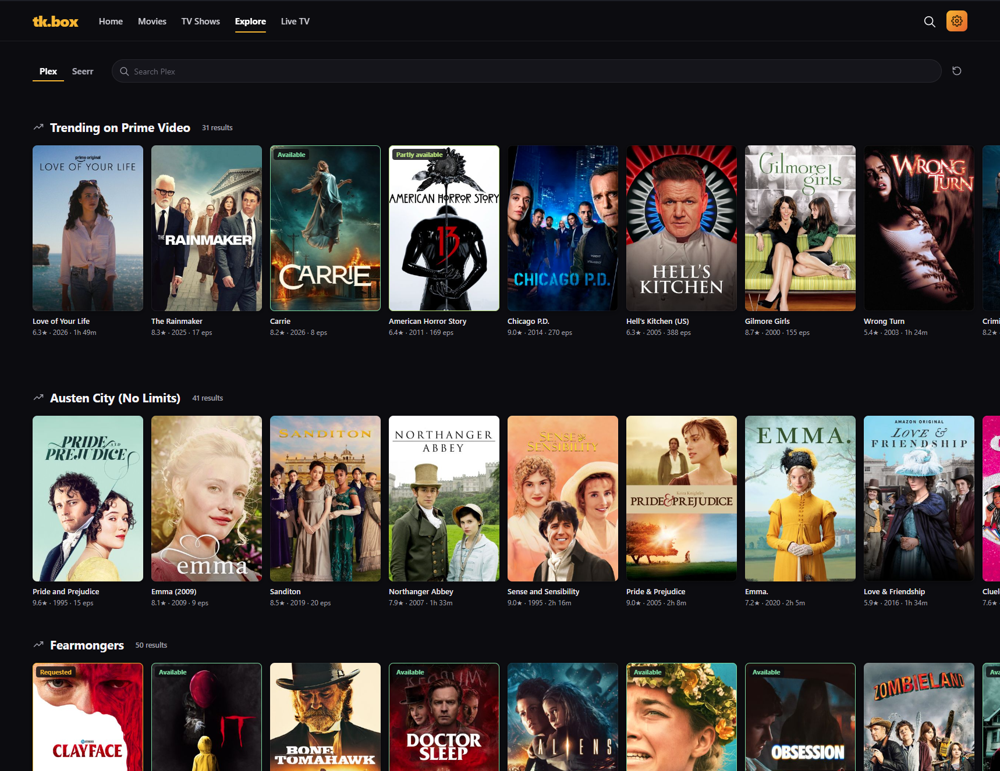

# tk.box

A self-hosted media app for your Plex library and IPTV channels. One web UI for browsing and watching Plex movies and shows, discovering new titles, a unified live TV guide, and custom always-on channels built from your Plex library.

> **Status:** early and in active development. Not production ready.



| Movies | Live TV |
| --- | --- |
|  |  |

## Features

- **Plex sign-in** with the official Plex PIN flow
- **Library browsing** — Home with featured titles and promoted collections, grid/list views, filters, sorting and an A–Z jump rail
- **Explore** — discover and search titles from Plex Discover, Seerr and Trakt, manage your Plex watchlist and request movies and shows through Seerr
- **Playback with resume** — Direct Play when the browser supports the file, otherwise Plex-transcoded HLS
- **Live TV** — import M3U/XMLTV sources, approve channels and watch through an FFmpeg relay, with a searchable guide and favorites
- **Plex Channels** — looping channels made from Plex movies, shows and collections, shared on one wall clock, with Pause, Resume and Go Live

## Explore

Browse every source's discovery shelves on one page, search them all at once, narrow shelves and results by language, release year and rating, and open title details to watch a local copy, add it to your Plex watchlist or request it through Seerr. Availability badges show which titles are available, partly available or already requested.

Plex Discover is available with Plex sign-in. Add optional Seerr and Trakt connections in **Admin → Connections**, and set which sources and rows Explore shows, and in what order, in **Admin → Explore**. A Seerr API key enables availability badges on Plex and Trakt titles; viewers request through their own Plex-linked Seerr accounts. Connect your own Trakt account for your watchlist and recommendations.



## Requirements

- Node.js 22 LTS or 24 LTS
- FFmpeg and ffprobe (with `libx264`, AAC and HLS support)
- A Plex Media Server with Movies and TV libraries

## Getting started

```sh
npm ci
cp .env.example .env        # set PLEX_URL and other settings
npm run setup:plex -- start # sign in at the printed Plex link
npm run setup:plex -- finish
node --env-file=.env --import tsx scripts/migrate.ts
node --env-file=.env --import tsx scripts/doctor.ts
npm run build
node --env-file=.env dist/apps/server/src/index.js
```

`setup:plex` verifies your server and writes its owner, machine and library IDs to `.env`. Your Plex token is never saved. `doctor` checks your configuration and FFmpeg.

Then open the configured address (`APP_HOST`:`APP_PORT`) and sign in with Plex.

## Development

```sh
npm run dev         # backend with reload
npm run dev:web     # Vite frontend
npm run typecheck
npm test
```

`npm run build && npm run preview:ui` serves a self-contained UI preview with synthetic data at `http://127.0.0.1:3011/__preview`.

## Project layout

| Path | Contents |
| --- | --- |
| `apps/server` | Fastify backend: Plex and IPTV providers, scheduling, streaming, SQLite persistence |
| `apps/web` | React frontend |
| `packages/contracts` | Shared types and settings |
| `scripts` | Setup, migrations, diagnostics and media experiments |
| `tests` | Test suite |
| `deploy` | Example systemd unit |
| `docs` | Design notes and guides |

## Docs

- [Deployment](docs/DEPLOYMENT.md)
- [IPTV ingestion and playback](docs/IPTV_INGESTION.md)
- [Plex Channels](docs/CUSTOM_CHANNELS.md)
- [Live Plex checks](docs/LIVE_PLEX_CHECKS.md)
- [Implementation status](docs/IMPLEMENTATION_STATUS.md)

## License

Released into the public domain under [The Unlicense](LICENSE). Dependencies keep their own licenses.
